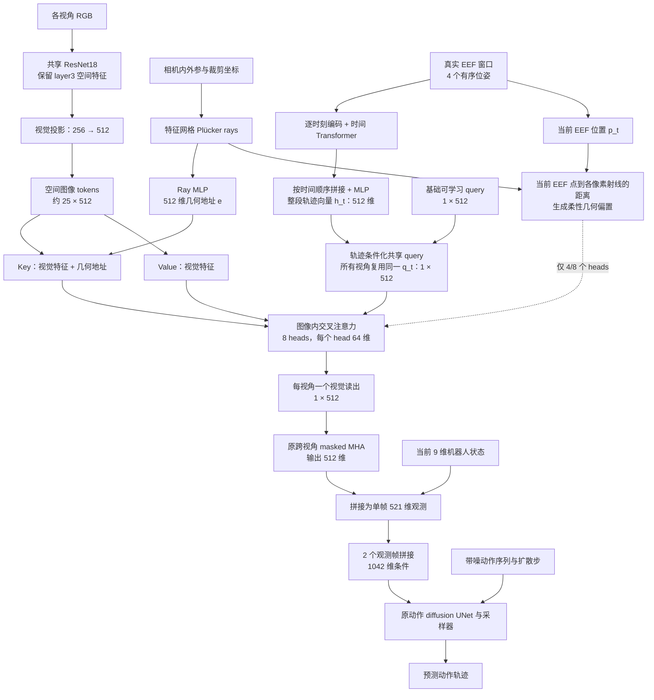
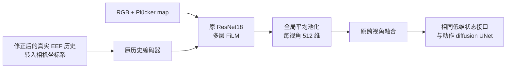

# Encoder 实验计划

版本：v0.9；更新日期：2026-10-29。状态：B、S、R 已训练并有结果（见 `PROGRESS.md`）；RH/RHG 已实现（CPU 测试通过，未训练）。  
配套资料：[参考文献与方法概括](ENCODER_REFERENCES.md)。

目标：在不使用场景深度的前提下，逐步检验空间读出、ray 编码、真实 EEF 历史查询和显式几何偏置的作用。动作 diffusion UNet 与现有低维状态接口保持一致。

## 1. 实验分组

| 实验 | 结构 | 主要回答的问题 |
|---|---|---|
| **B** | 原 encoder，使用修正后的历史定义 | 历史问题处理后，旧结构达到什么水平 |
| **S** | 空间图像 tokens＋1 个跨视角共享的 512 维可学习 query，8 heads；无 ray 编码、无历史条件 | 空间读出这类结构本身是否有效 |
| **R** | S＋特征层 ray 编码 | 在空间特征上加入几何地址是否有效 |
| **RH** | R＋完整 EEF 轨迹条件化，共享 query 仍为 1 个、512 维 | 状态引导视觉读取是否有效 |
| **RHG** | RH＋当前 EEF 点到射线的几何偏置 | 显式几何关系是否进一步有效 |

比较顺序为 **S−B、R−S、RH−R、RHG−RH**。S−B 是整体结构比较；其余三项分别检验 ray、完整轨迹条件和几何偏置的增量。S/R 的“无历史条件”仅指视觉读取分支，动作头仍接收已有当前机器人状态。

## 2. 各阶段信息流

下表记录每阶段相对前一阶段新增或调整的路径；B 为基线。

| 阶段 | 新增或调整的模块 | 信息流 | 本阶段的信息变化 |
|---|---|---|---|
| **B** | 修正历史读取，沿用原 encoder | RGB＋Plücker map → 原 ResNet；真实 EEF 历史 → 原历史编码器 → 各层 FiLM；最终全局平均池化为每视角 512 维 | 历史改为每帧对应的真实过去窗口 |
| **S** | 纯 RGB backbone 保留 layer3；256→512 视觉投影；1 个共享 query；8-head 图像内 cross-attention | RGB → 25×256 → 投影为 25×512 空间 tokens → K/V；共享 1×512 query → Q；注意力 → 每视角一个 512 维读出 | 新增空间读出机制；移除 B 的输入层 Plücker 拼接及历史 FiLM，视觉分支只接收 RGB |
| **R** | Ray MLP、特征层几何融合 | 相机内外参＋裁剪坐标 → Plücker rays → ray embedding e；视觉特征 f＋e → K，V 仍来自 f | 相机几何通过 key 影响空间检索 |
| **RH** | 逐时刻历史编码、时间 Transformer、整段轨迹汇总与 query 条件化 | 4 个有序 EEF 位姿 → 时间编码器 → 按时间顺序拼接并投影为一个 h_t → 条件化共享 query；同一 q_t 用于所有视角 | 完整轨迹通过 Q 引导读取哪些视觉 tokens |
| **RHG** | 点到射线距离计算、attention 几何偏置 | 当前 EEF 位置 p_t＋各像素 ray → 距离 → 偏置 b → 加入共享 query 的 4/8 个 heads 的 attention logits，再做 softmax | 将已有机器人与相机输入之间的明确几何关系加入检索，无新增原始观测 |

各组共同的后续路径：**每视角 512 维 → 原跨视角融合 → 512 维＋当前 9 维机器人状态 → 单帧 521 维 → 两帧拼接 1042 维 → 原动作 diffusion UNet**。当前状态始终保留；RH/RHG 的历史只通过查询与几何偏置影响视觉读取，不直接拼接到视觉读出。

## 3. 模型整体结构

### 3.1 RHG 完整结构

同一观测时刻的所有视角共用一个 512 维 query。图像编码与空间读取对每个有效视角分别进行、共享权重，每视角输出一个视觉 token，再沿用原跨视角融合。

S/R 使用同一个基础可学习 query；RH/RHG 在此基础上加入整段轨迹条件，不增加 query 数量。R 起启用 ray 分支，RHG 才启用几何偏置。

### 3.2 B：原 encoder 基线

## 4. 关键结构定义

### 4.1 统一设置

| 项目 | 设定 |
|---|---|
| 图像与特征 | 84×84 RGB，沿用 76×76 crop；S—RHG 用纯 RGB ResNet18 的 layer3，约 5×5×256，再投影为 25×512 空间 tokens |
| 共享 query | S—RHG 每视角使用 1 个 512 维 query；同一时刻所有视角共享参数与 query 内容 |
| 空间读取 | 1 层交叉注意力，8 heads，内部宽度 512，每个 head 64 维；每视角输出 1×512 |
| 历史窗口 | H=4 个连续观测时刻；覆盖时长为 3×采样间隔，运行前确认实际秒数 |
| 历史内容 | EEF 位置、姿态和时间顺序；历史夹爪状态暂不加入 |
| 完整轨迹条件 | RH/RHG 编码窗口内全部 4 个有序位姿，汇总为一个 512 维 h_t，再条件化共享 query |
| 坐标与尺度 | 新结构的轨迹和 rays 统一到 robot base；L=1 m，仅用于位置与 ray moment 的数值归一化 |
| 跨视角融合与接口 | 每视角一个 512 维 token → 原 masked MHA → 512 维；随后拼接原 9 维状态 |
| 位置与损失 | 首轮不添加额外二维位置编码；只使用 diffusion loss |

### 4.2 Ray 编码：R、RH、RHG

在裁剪后特征网格对应的原图位置计算单位射线方向 d，相机中心为 o，Plücker moment 为 m：

\[
m=o\times d,\qquad e=E_{ray}([d,m/L]).
\]

设 f 为从 ResNet 的 256 通道投影到 512 维的视觉 token，ray embedding e 也为 512 维；f+e 为逐元素相加：

\[
k=W_K\operatorname{LN}(f+e),\qquad
v=W_V\operatorname{LN}(f).
\]

ray 提供检索用的几何地址，value 保留视觉内容。S 使用 e=0。图像 crop 与 ray 坐标必须同步，不使用深度或候选深度采样。

**R 实现说明（2026-10-29）。** 特征网格与像素的对应采用 resnet18 的对称 padding 约定：stride 为 16（conv1 s2 × maxpool s2 × layer2 s2 × layer3 s2），layer3 单元 `(i, j)` 对应裁剪后像素 `(16i, 16j)`，即原图坐标 `(off_h + 16i + 0.5, off_w + 16j + 0.5)`；`off` 是本次样本实际采样的 crop 左上角，与图像共用同一个窗口。射线用**原图**的内参（fovy 与主点）计算，不用裁剪后尺寸重算。`e` 只加到 key；输出层零初始化，且共享 query 沿用 S 的零初始化，因此初始化时 query 为零、注意力 logits 恒为零，key 路径（含 ray MLP）在第一步之后才“点亮”，ray MLP 的第一层再晚一步——到首个 epoch 的 latent probe 时（数百步之后）ray 分支已生效。`use_ray_encoding=False` 是“切断 ray”的诊断消融（参数不变，e 恒为 0）。R 编码器参数 5,284,928（S 为 5,016,640），因此 R−S 仍是结构比较而非等容量比较。

### 4.3 完整轨迹条件化共享 query：RH、RHG

每个图像时刻 t 对应完整窗口：

\[
\mathcal T_t=\{(p_i,R_i)\}_{i=t-3}^{t}.
\]

将各时刻的位置、姿态、相对当前位置和时间编码输入小型时间 Transformer，再将 4 个输出按时间顺序拼接，经 MLP 汇总为单个 512 维轨迹向量 h_t：

\[
h_t=E_{traj}(\mathcal T_t),\qquad
q_t=q^{learned}+W_hh_t\in\mathbb R^{512}.
\]

“完整”指输入窗口内全部 4 个有序位姿，不包含未来状态，也不表示汇总向量必然保留所有细节。每个图像时刻生成一个 q_t，所有有效视角复用；S/R 只使用基础 q^{learned}。空间注意力在每个 head 内将同一个 query 投影为 64 维，产生各自的空间注意力图，8 个 head 输出拼接并投影为一个 512 维视觉 token。不将原始 query 或历史向量直接残差加入视觉读出。

**RH/RHG 实现说明（2026-10-29）。** 历史窗口 H=4 个连续观测帧；数据缓冲按 20 Hz 控制步逐帧记录，故窗口覆盖 3×0.05 s = **0.15 s** 的真实 EE 运动（§4.1 “运行前确认实际秒数”的结论；训练 `eef_hist_window='episode'` 与两条 rollout deque 的语义一致）。编码器为 `traj_spatial_readout_obs_encoder.TrajSpatialReadoutObsEncoder`，RH 与 RHG 是同一类的两个 flag 设置（`use_geom_bias=False/True`），不增加任何参数、构造时不消耗 RNG，因此两者**初始参数逐位相同**，RHG−RH 是干净的单变量比较。轨迹输入为数据集新增的 `eef_hist_base`：每样本 `(To, H, 9)`，基座坐标，`[pos(3), rot6d(6)]` 每步，oldest→current，不含夹爪，**视角无关**；数值保持米（normalizer 为恒等）。每步特征为 `[p_i/L, rot6d_i, (p_i-p_t)/L, age]`（13 维，age 由 −1 到 0），加可学习步序嵌入后进 1 层、4 head、宽度 128、FFN 256 的时间 Transformer；4 个输出按时间顺序拼接（512 维）经 `512→512` MLP 得 h_t，再经 `W_h`（权重与偏置均零初始化）加到零初始化的 `q^{learned}`：初始化时 q_t 恒等于 `q^{learned}`，轨迹分支逐位惰性；h_t 非零，所以 W_h 在第一步获得梯度、第二步点亮，时间编码器再晚一步（项目既有的零初始化链）。`q^{learned}` 的个数不变（仍为 1），跨视角融合 query 仍是独立参数。RH 编码器参数 6,207,680（R 为 5,284,928，增加 922,752），因此 RH−R 是结构比较、非等容量比较；RHG 与 RH 参数完全相同。

### 4.4 几何偏置：仅 RHG

共享 query 由整个历史窗口条件化；几何偏置使用当前 EEF 位置 p_t 作为统一锚点。对第 v 个视角、第 j 个空间 token：

\[
\rho_{v,j}=\|p_t\times d_{v,j}-m_{v,j}\|,
\qquad
b_{v,j}=-\alpha\min\left(\frac{\rho_{v,j}^2}{2\sigma^2},b_{max}\right).
\]

\[
a^{(r)}_{v,j}=\operatorname{softmax}_j
\left((q_t^{(r)})^\top k^{(r)}_{v,j}/\sqrt{64}+b^{(r)}_{v,j}\right),
\qquad r=1,\ldots,8.
\]

第 1—4 个 heads 使用 b^{(r)}=b，第 5—8 个 heads 使用 b^{(r)}=0；全部 heads 都使用完整轨迹条件化的 query。初始固定 alpha=1、b_max=4；sigma 使用米，在训练集上按约 1—2 个特征网格邻域校准后锁定，距离计算使用原始物理坐标。

当前 EEF 点位于相机后方或投影在裁剪外时，关闭该视角的距离偏置，保留内容注意力。图像内投影不保证无遮挡；偏置保持柔性，不做硬遮罩。

**RHG 实现说明（2026-10-29）。** 偏置以加性 mask 送入 `nn.MultiheadAttention`（`attn_mask` 形状 `(N·heads, 1, G)`，仅前 `geom_bias_heads=4` 个 head 非零），softmax 之前加入，与上式逐项一致；CPU 测试用同一组投影权重手工复算 0/1/4/8 个 head 的结果并逐位对齐。ρ 用米：存储的 ray moment 先乘回 `ray_scale`；`ray_scale` 同时用于轨迹位置归一化（L=1 m）。有效性门使用**原图**内参与本次样本的 crop 左上角：`depth>0` 且投影 `(u,v)` 落在 `[off, off+crop)` 内，否则该视角所有 token 的 b=0。`geom_bias_sigma_m` 必须在构造时给出，否则直接报错——它由 `calibrate_geom_bias.py` 在训练 zarr 上一次性标定并锁定：对每个 EE 投影落在 crop 内的 (state, obs step, view)，取投影最近 token 的 4 邻域（1 格）point-to-ray 距离的中位数作为 sigma；报告 1 格/2 格距离分位数与对应隐含偏置，写入 `data/enc_rhg_calib_square.json` 与运行目录日志，`data/enc_rhg_run.sh` 断言解析后的配置携带同一数值。RH 的配置不出现任何 `geom_bias_*` 键；RHG 配置把 sigma 设为 `null`，缺校准覆盖时启动即失败。

## 5. 统一历史协议

当前训练侧历史在采样窗口起点截断，而在线评估使用滚动历史。所有实验先统一为：

- 以每帧图像时刻为终点，读取同一 episode 内真实过去 4 个 EEF 位姿。
- 仅在 episode 起点重复首状态填充，不在普通采样窗口起点填充。
- 训练与在线使用相同采样间隔、时序、姿态约定；不读取未来或跨 episode 状态。
- B 保留原相机坐标系条件路径；RH/RHG 使用统一 base 坐标系轨迹，并核对跨视角变换一致性。

B 需在修正协议后重新训练，作为本轮匹配基线。

## 6. 训练与评价

| 项目 | 统一协议 |
|---|---|
| 任务 | robomimic square PH，绝对动作 |
| 训练视角 | 11-view 池：−75/−60/−45/−30/−15/0/+15/+30/+45/+60/+75°；ring indices 为 `[1,2,3,4,5,6,7,8,9,10,11]` |
| 每样本视角数 | K=11 个槽位，N 均匀取 1—11，无放回抽样；B、S、R、RH、RHG 使用相同分布 |
| 动作设置 | horizon=16，观测帧数=2，n_action_steps=8 |
| 训练预算 | 沿用原优化器、学习率、batch 与 EMA；201 epochs，主要比较 EMA epoch 200 |
| 随机种子 | 42 完成五组初筛；关键相邻比较补 43、44 |
| 评价设置 | N=1；按分布内、插值、分布外、俯仰角四类分别汇总，具体视角见下表 |
| Rollout | 每视角 50 个配对 episode，固定环境与 diffusion 随机种子 |
| 报告 | 每视角成功率、集合均值、相邻实验差值、训练种子间波动、参数量与推理开销 |

角度均相对基准相机；el=0° 表示基准俯仰，俯仰变化采用绕观察目标的轨道调整。

| 评价类别 | 方位角 az | 俯仰变化 el | 汇总方式 |
|---|---|---|---|
| **分布内** | 0、±15、±30、±45、±60、±75°（11 个） | 0° | 11 视角平均严格成功率 |
| **插值** | ±7.5、±22.5、±37.5、±52.5、±67.5°（10 个） | 0° | 10 视角平均严格成功率，作为主要指标 |
| **分布外** | ±82.5、±90°（4 个） | 0° | 4 视角平均严格成功率及各视角结果 |
| **俯仰角** | 0° | ±15°；另测 0° 作一致性对照 | ±15° 的均值和单独结果；0° 对照单列 |

分布内使用训练位姿；插值位于训练方位角范围内但未参与训练；分布外超出训练的 ±75° 范围。现有 `azimuth_interp` 对应本轮分布内集合，`azimuth_offgrid` 拆分为插值和分布外，`elevation_az0` 对应俯仰角集合。

数据划分、增强、动作头和训练预算在各组间保持一致，不按评价视角成功率挑 checkpoint；四类结果分别报告，不合并为一个总均值。

## 7. 执行顺序与记录

1. 核对历史、坐标变换、crop/ray 对齐和点线距离；完成 B。
2. 依次训练 S、R、RH、RHG，按相邻差值判断新增模块的作用。
3. 对关键比较补训练种子；必要时补关闭偏置、扰动标定和打乱历史顺序的诊断。
4. 主线完成后，再单独讨论窗口长度、query 数、二维位置编码或辅助表征损失。

| 实验 | 状态 | 主要对照 |
|---|---|---|
| B | 已训练（B0/B1，见 `PROGRESS.md`） | 原结构的修正历史基线 |
| S | 已训练（见 `PROGRESS.md`） | B |
| R | 已训练（见 `PROGRESS.md`） | S |
| RH | 已实现（2026-10-29），待训练 | R |
| RHG | 已实现（2026-10-29），待训练 | RH |

每次运行记录文档版本、配置/代码版本、历史窗口秒数、训练种子、checkpoint、逐视角结果及相邻比较。后续讨论统一使用 B、S、R、RH、RHG。

### 7.1 实现文件清单（B、S、R、RH/RHG）

| 阶段 | 编码器 | task 配置 | workspace 配置 | 运行/评测 | 测试 |
|---|---|---|---|---|---|
| B | `diffusion_policy/model/vision/view_conditioned_obs_encoder.py` | `config/task/enc_b_image_abs_multiview_az75.yaml` | `config/train_diffusion_unet_image_workspace_enc_b_latent.yaml` | `data/enc_b_run.sh` / `data/enc_b_eval.sh` | `tests/test_view_conditioned_obs_encoder.py` |
| S | `diffusion_policy/model/vision/spatial_readout_obs_encoder.py` | `config/task/enc_s_image_abs_multiview_az75.yaml` | `config/train_diffusion_unet_image_workspace_enc_s_latent.yaml` | `data/enc_s_run.sh` / `data/enc_s_eval.sh` | `tests/test_spatial_readout_obs_encoder.py` |
| R | `diffusion_policy/model/vision/ray_spatial_readout_obs_encoder.py`（+ `model/vision/plucker.py` 新增 `plucker_ray_map_at` / `ray_dirs_cam_at`） | `config/task/enc_r_image_abs_multiview_az75.yaml` | `config/train_diffusion_unet_image_workspace_enc_r_latent.yaml` | `data/enc_r_run.sh` / `data/enc_r_eval.sh` | `tests/test_ray_spatial_readout_obs_encoder.py` |
| RH | `diffusion_policy/model/vision/traj_spatial_readout_obs_encoder.py`（RH/RHG 同一个类，`use_geom_bias` 区分） | `config/task/enc_rh_image_abs_multiview_az75.yaml`（RH/RHG 共用；`emit_eef_hist_base: true`、`serve_eef_hist_base: true`） | `config/train_diffusion_unet_image_workspace_enc_rh_latent.yaml` | `data/enc_rh_run.sh` / `data/enc_rh_eval.sh`（eval 需 `--serve-eef-hist-base`） | `tests/test_traj_spatial_readout_obs_encoder.py`；`tests/test_multiview_dataset.py` / `tests/test_latent_probe_hook.py` 扩展 |
| RHG | 同上（`use_geom_bias: true`，σ 由 `calibrate_geom_bias.py` 标定并锁定） | 同上 | `config/train_diffusion_unet_image_workspace_enc_rhg_latent.yaml` | `data/enc_rhg_run.sh`（含 σ 标定阶段）/ `data/enc_rhg_eval.sh` | 同上 |

共享管线新增一个 seam：`diffusion_policy/dataset/multiview_image_dataset.py` 的 `emit_eef_hist_base`（默认 `False`，所有已提交运行不变）与 `eef_hist_base()` 变换；`env_runner/cam_key_image_runner.py` 与 `eval_novel_view.py` 的 `serve_eef_hist_base`（默认 `False`）；`train_diffusion_unet_image_workspace_latentprobe.py` 把数据集发出的额外 per-sample obs 键原样带进两种 probe draw（base 返回空，已提交运行的 probe 产物不变）。

共享管线不变：`diffusion_policy/dataset/multiview_image_dataset.py`（slot/cam/mask/history 与 `eef_hist_window`）和 `diffusion_policy/workspace/train_diffusion_unet_image_workspace_latentprobe.py`（latent probe）。S 的运行目录为 `/data/zihan/runs/run_square_enc_s_s42_200ep`（201 epochs，seed 42，K=11，pool 1..11，probe 128/az0_view 6）；R 为 `/data/zihan/runs/run_square_enc_r_s42_200ep`，数据、slot、pool、N 分布、seed、epoch 数与 probe 完全相同。S 的 dataset/runner 仍按 B 的 schema 发出相机向量与 EE 历史；S 的 encoder 忽略它们，这是为了让 S−B 保持单变量结构比较，且不改动已提交的数据/runner/probe schema。R 与 S 的唯一结构差异是 ray 地址；评测结果见 `PROGRESS.md`：R−S 分布内 −0.051、插值 −0.014，均在 0.15 带内，且未恢复到 B1（−0.211 / −0.180）。

S 结构一句话：76×76 crop → 纯 RGB ResNet18 layer3 5×5×256 → 1×1 conv 256→512 → 25×512 空间 tokens → 1 个共享的零初始化 512 维 query（8 heads，图像内 cross-attention）→ 每视角 1×512 → 原 M3 masked MHA 融合 → 521；无 ray、无 FiLM、无二维位置编码。参数量 5,016,640（B 为 12,532,928），因此 S−B 是结构比较，不是等容量比较。

## 8. 实验与模块的文献依据

下表区分文献中可借鉴的方法和本项目的具体改造；链接指向配套文献文档中的原文链接与概括。

| 实验 / 模块 | 文献依据 | 借鉴内容与本项目改造 |
|---|---|---|
| **B：动作框架与原 FiLM 条件化** | [R12 Diffusion Policy](ENCODER_REFERENCES.md#r12)、[R11 FiLM](ENCODER_REFERENCES.md#r11) | 沿用动作扩散框架和逐通道仿射调制；EEF 历史作为 FiLM 条件是项目已有实现 |
| **B：真实历史窗口修正** | 项目数据读取与在线缓冲区审计，无直接论文依据 | 统一训练与在线的时间语义，属于输入协议修正 |
| **S：空间 tokens＋共享 query＋交叉注意力** | [R01 PETR](ENCODER_REFERENCES.md#r01) | 借鉴保留二维空间 tokens、由可学习 queries 读取的结构；改为一个跨视角共享 query；S 使用纯 RGB tokens，不引入 PETR 的三维位置编码或候选深度 |
| **S：512 维投影与单 token 读出** | 项目接口设计；[R12 Diffusion Policy](ENCODER_REFERENCES.md#r12) 提供动作框架背景 | 视觉特征从 256 投影到 512 维，单 query 通过 8 heads 直接读出一个 512 维 token，接入已有跨视角融合与动作接口 |
| **R：独立 ray 编码器** | [R03 CameraCtrl](ENCODER_REFERENCES.md#r03)、[R04 Cameras as Rays](ENCODER_REFERENCES.md#r04) | 借鉴独立编码相机条件、patch 与 Plücker ray 对应的表示；本项目使用特征网格上的 Ray MLP，不复现视频多尺度注入或 ray 去噪 |
| **R：特征层几何融合** | [R01 PETR](ENCODER_REFERENCES.md#r01) | 借鉴几何位置编码与视觉特征相加；改用 ray embedding，且只加入 key、value 保留视觉内容是本项目选择 |
| **RH：机器人状态引导视觉读取** | [R02 3D Diffuser Actor](ENCODER_REFERENCES.md#r02) | 借鉴机器人状态与空间视觉 tokens 的注意力交互；改为无深度的完整 EEF 轨迹条件化共享 query，并保留原动作 UNet |
| **RH：时间编码器与完整轨迹汇总** | 项目结构设计；[R02](ENCODER_REFERENCES.md#r02) 仅提供状态与视觉交互动机 | 用时间 Transformer 编码全部 4 个有序位姿，再按序汇总为 h_t，条件化单个 512 维 query；此组合并非论文原结构 |
| **RHG：点到射线的 attention 偏置** | [R07 Geometry-biased Transformers](ENCODER_REFERENCES.md#r07) | 借鉴几何距离进入 attention logits；将论文的 ray-to-ray 关系改为当前 EEF point-to-ray，并仅在共享 query 的 4/8 个 heads 中加入偏置 |

1 个跨视角共享 query、完整轨迹条件化、512 维宽度、8 heads、layer3 及几何偏置的锚点/宽度/强度均为本项目实验设定，需由对照实验验证；上述论文不直接证明这些具体配置最优。
