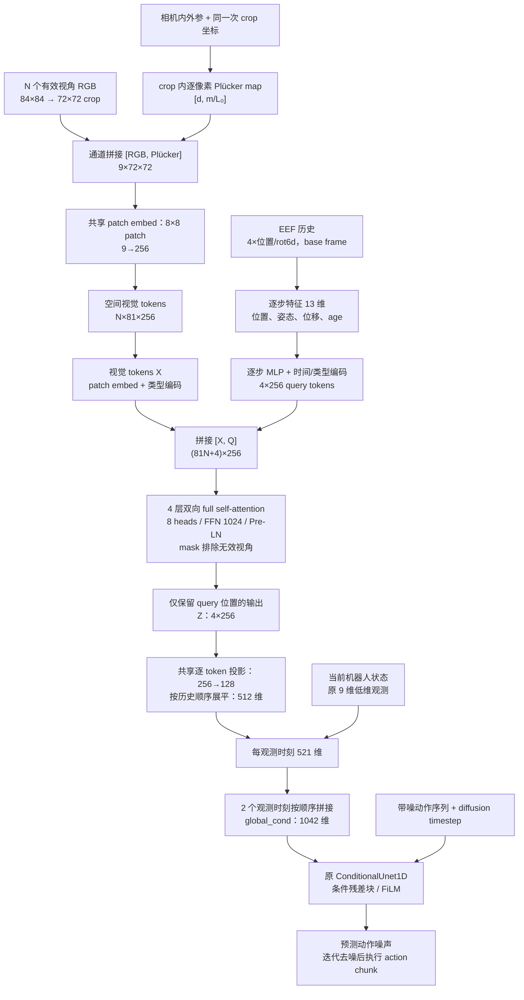

# 首版改进方案：LVSM RGB＋Plücker patchify 与 EEF 历史查询的双向 Transformer

版本：v0.2；日期：2026-10-29。状态：设计已锁定；编码器与 CPU 测试已实现（`tests/test_lvsm_eef_query_obs_encoder.py` 通过），尚未训练；文中的默认值为锁定方案，不表示已验证的最优配置。实验阶段代号 **LQ**。

v0.1 → v0.2 的唯一结构改动：tokenizer 从 ResNet18 layer3 特征＋中心 ray MLP 改为 **LVSM 原版 RGB＋Plücker 9 通道、8×8 patchify＋线性 patch embed**（无 ResNet）。由于 76 不能被 8 整除，crop 由 76×76 改为 **72×72**（9×9＝81 tokens/视角）。EEF 历史 query、联合 Transformer、输出头与 521/1042 接口不变。其余 v0.2 改动只记录已锁定的实验选择，不改变模型。

配套资料：[现有 encoder 实验计划](ENCODER_EXPERIMENT_PLAN.md)、[实验进展](PROGRESS.md)、[参考文献](ENCODER_REFERENCES.md)。本方案作为独立候选记录，不改写 B/S/R/RH/RHG 的定义和实验结果。

## 1. 目标与首版范围

用同一个双向 full self-attention Transformer，联合处理所有有效视角的空间视觉 tokens 与 EEF 历史生成的 query tokens。最后丢弃视觉位置的输出，只保留 query 位置的输出，作为下游 diffusion UNet 的条件。

核心假设是：在压缩成固定宽度条件之前，让空间视觉信息跨视角交换，并允许 EEF 历史反向影响视觉 tokens 的更新，能够得到更适合动作生成的条件表示。是否改善单相机新视角控制，需要闭环实验验证。

首版信息流为：

```text
所有有效视角 RGB + 对齐的 Plücker 几何 → 空间视觉 tokens X
base-frame EEF 历史                 → 历史 query tokens Q
                                  ↓
                     拼接 [X, Q]，多层双向 self-attention
                                  ↓
                 丢弃 X 对应输出，只保留 Q 对应输出 Z
                                  ↓
                     逐 token 投影 → 按历史顺序展平
                                  ↓
                 拼接当前机器人状态 → diffusion UNet 条件
```

query 来源是已观测的真实 EEF 历史；其输出是包含视觉上下文的历史表示，不预设为未来某一步动作的表示。

原有“每视角先读出一个向量，再用独立 MHA 汇总”的两阶段路径被联合 Transformer 替代。跨视角融合发生在全局 self-attention 内；最后的逐 token 线性投影与展平只负责适配条件宽度。

## 2. 首版建议配置

| 项目 | 建议默认值 | 选择理由 |
|---|---|---|
| 图像 | 84×84 RGB，裁剪为 **72×72**（76 不能被 8 整除） | 采用 LVSM 原版 8×8 patch；crop 变化是同 crop 对照的后续课题 |
| 视觉 tokenizer | **LVSM 原版：RGB＋Plücker 9 通道，8×8 patch，共享线性 patch embed 9→256；无 ResNet** | 直接采用 LVSM 的 tokenizer，不再经过 CNN 特征 |
| 每视角 token 数 | 9×9 网格，共 **G=81** 个 | K=11 时联合序列 895 tokens；需实测显存与吞吐 |
| 几何输入 | **crop 内逐像素的 base-frame Plücker ray `[d, m/L₀]`，与 RGB 在通道维拼接后一起 patchify**（无 ray MLP） | 几何在 patchify 之前进入，影响全部 token 与 Q/K/V |
| 模型宽度 | D=256 | 与 patch embed 输出对接，控制首版参数和显存 |
| EEF 历史 | H=4，oldest→current；位置、rot6d、相对当前位置和 age | 沿用已修正的真实历史接口 |
| query 数量 | R=H=4，每个历史位姿对应一个 token | 来源与顺序明确；不先压缩整段历史 |
| query 编码 | 共享逐步 MLP `13→256→256`，加历史步序和 token 类型 embedding | 由联合 Transformer 继续建模历史时序，不额外叠加时间 Transformer |
| 联合 Transformer | L=4 层；8 heads；FFN=1024；Pre-LN；GELU；dropout=0 | 支持多轮双向交互；2/6 层作为后续容量比较 |
| 输出 | 保留 4 个 query；共享 `LayerNorm→Linear(256,128)`；按历史顺序展平 | `4×128=512`，不做池化或额外 attention 汇总 |
| 单观测时刻接口 | 512 维联合条件＋原 9 维机器人状态＝521 维 | 保留当前状态直达动作头的路径 |
| UNet 条件 | 2 个观测时刻按顺序拼接，1042 维 `global_cond` | 保留现有 UNet 结构、动作归一化和去噪接口 |
| 训练采样 | 相同状态的同步多视角；11-view 池；N 均匀采样 1—11，无放回选视角 | 与现有 B/S/R/RH/RHG 协议对照 |
| 训练目标 | 仅 diffusion epsilon MSE，encoder 与 UNet 端到端联合训练 | 先检验信息流，不引入新损失 |

上述宽度是便于启动的配置，不是论文推导出的必要条件。v0.2 直接采用 LVSM 原版 RGB＋Plücker patchify（8×8 patch，crop 72）；ResNet-layer3 特征＋中心 ray 版本改为第 6 节的替代方案，不再作为首版默认。

## 3. 模型简图

图中张量形状对应一个观测时刻，省略 batch 轴。两个观测时刻分别调用同一个 encoder，再按时间顺序拼接。



## 4. 关键公式与信息流

### 4.1 记号与时间范围

| 符号 | 含义 | 首版数值 |
|---|---|---|
| B | 策略训练 batch size | 64 |
| Tₒ | 策略接收的观测时刻数 | 2 |
| K / N | 最大视角槽位数 / 某样本有效视角数 | 11 / 1—11 |
| G | 每视角空间视觉 token 数 | **81** |
| p / crop | patch 边长 / 裁剪尺寸 | **8 / 72×72** |
| H / R | EEF 历史步数 / 输出 query 数 | 4 / 4 |
| D / d_z | Transformer 内部宽度 / 单个输出 token 宽度 | 256 / 128 |
| L | 联合 Transformer 层数 | 4 |
| L₀ | 长度数值归一化尺度 | 1 m |
| Tₐ | diffusion 动作 horizon | 16 |

对每个观测时刻 t 独立构造输入。历史窗口为 `{t−3,t−2,t−1,t}`，每帧使用自己的真实过去窗口；两个观测时刻的窗口允许重叠。按当前 20 Hz 数据协议，4 步覆盖 0.15 s，执行时应核对实际记录频率与 runner deque 的间隔。

联合 Transformer 不把两个图像时刻混为一个序列。现有策略将 `(B,Tₒ,...)` 展开成 `(B·Tₒ,...)` 调用 encoder，随后还原并展平。跨图像时刻的融合仍由 UNet 对全局条件的处理承担。

### 4.2 空间视觉 token 与 Plücker 几何

相机 v 的中心、camera-to-base 旋转分别为 `o_v`、`R_v`。像素中心 `(u,w)` 对应单位相机射线 `d_cam(u,w)`，由内参和相机轴约定得到：

\[
d_{v,u,w}=R_v d_{\mathrm{cam}}(u,w),\qquad
m_{v,u,w}=o_v\times d_{v,u,w},\qquad
r_{v,u,w}=[d_{v,u,w},m_{v,u,w}/L_0].
\]

相机外参和 EEF 位姿必须先统一到同一坐标系。本项目的 `eef_hist_base` 与相机位姿都来自同一份存储的 robomimic world frame（dataset 里的 “base” 是命名约定，不做变换）；两侧必须使用同一约定。若未来 simulator world 与 robot base 不同，应先转换相机位置与旋转并核对投影，不能只把 world 字段改名为 base。射线表示观察直线，不提供该像素物体表面的深度。

裁剪后的 RGB `I_v` 与同一 crop 窗口的 Plücker map 按通道拼接：

\[
P_v=\bigl\{r_{v,u,w}\mid (u,w)\in \mathrm{crop}\bigr\}\in\mathbb R^{6\times72\times72},
\qquad
x_v=\operatorname{Cat}(I_v,P_v)\in\mathbb R^{9\times72\times72}.
\]

共享的线性 patch embed（实现为 8×8、stride 8 的卷积）把每个不重叠 patch 映射为 D 维 token：

\[
X_v=\operatorname{PatchEmbed}_{p=8}(x_v)\in\mathbb R^{81\times D},
\qquad
x_{v,j}^{(0)}=
\operatorname{LN}_{x}\left(W_p\,\mathrm{patch}_j+e_{\mathrm{visual}}\right)\in\mathbb R^D.
\]

`W_p` 是共享的 `9·8²→256` 线性层；同一个 tokenizer 用于全部相机；不添加 slot ID 或展平后的全局序号 embedding。首版以逐像素 Plücker 提供空间/视角地址，额外二维位置编码作为后续选项。

crop 默认沿用现有实现：每个有效图像独立采样 72×72 窗口（84→72 的中心 crop 偏移为 (6,6)，训练时随机 crop），Plücker map 使用**同一个** crop 偏移和**原图**内参逐像素计算；eval 用中心 crop。76 不能被 8 整除，因此 v0.2 的 crop 必须为 72（或 80），不能沿用 76。

与现有 R 的区别是：R 在 ResNet 特征格的 key 上加入 ray embedding；本方案在 patchify 之前把逐像素 Plücker 与 RGB 拼接，几何信息进入每个 patch token 的输入，再由各层共同产生 attention 的 Q/K/V。这是 LVSM 原版的做法，不再使用特征格中心 ray 的近似。

### 4.3 EEF 历史生成 query tokens

历史采用 `eef_hist_base`：每观测时刻 `(H,9)`，包含位置 3 维与 rot6d 6 维，oldest→current，不含历史夹爪。第 i 个历史状态的逐步特征为：

\[
f_i=\left[
p_i/L_0,\;\operatorname{rot6d}(R_i),\;(p_i-p_t)/L_0,\;a_i
\right]\in\mathbb R^{13},
\qquad
a_i=\frac{i-(H-1)}{H-1},\quad i=0,\ldots,H-1.
\]

首版 `H=4`，若扩展到 `H=1`，单独定义 `a_0=0`。建议 query 为：

\[
q_i^{(0)}=\operatorname{LN}_{q}
\left(E_h(f_i)+e_i^{\mathrm{time}}+e_{\mathrm{eef}}\right)
\in\mathbb R^D.
\]

`E_h` 是共享 `13→D→D` 的 GELU MLP；`e_i^time` 是每个历史位置的可学习 embedding，`e_eef` 是所有历史 tokens 共用的类型 embedding。保留绝对 base 位置用于对齐相机射线，位移项显式提供局部运动信息；两者都不是未来动作。

首版不先把 H 步汇总成一个向量，也不额外使用独立时间 Transformer。联合 Transformer 允许历史 tokens 彼此交换信息。年龄数值与可学习步序分别提供时间量和位置身份；是否同时需要二者可在后续简化。

历史 tokens 不需要复制到各个相机：一份 base-frame 历史即可面对所有视角。`R=H` 是首版选择，不是 attention 或 UNet 的约束。

### 4.4 双向 Transformer

拼接全部视觉 tokens 和 query tokens：

\[
S^{(0)}=[X^{(0)},Q^{(0)}]
\in\mathbb R^{(NG+R)\times D}.
\]

每层采用 Pre-LN 残差块：

\[
\widehat S^{(\ell)}=S^{(\ell)}+
\operatorname{MHA}_{\ell}\left(
\operatorname{LN}_{\ell,1}(S^{(\ell)});M\right),
\]

\[
S^{(\ell+1)}=\widehat S^{(\ell)}+
\operatorname{FFN}_{\ell}\left(
\operatorname{LN}_{\ell,2}(\widehat S^{(\ell)})\right).
\]

每个 attention head 的计算为：

\[
\operatorname{Attn}(S)=
\operatorname{softmax}\left(
\frac{(UW_Q)(UW_K)^\top}{\sqrt{D/n_h}}+M
\right)(UW_V),\qquad U=\operatorname{LN}(S).
\]

实际实现包含多头拼接和输出投影；历史 query tokens 是序列中的一类 token，不能与每层投影后的 attention Q 矩阵混淆。在 full self-attention 内，视觉和历史两类 tokens 都产生自己的 Q/K/V。

有效 token 对之间不设置方向限制，四个分块均开放：视觉→视觉、视觉读取历史、历史读取视觉、历史→历史。所有历史都不晚于该序列的观测终点 t，因此窗口内全双向不泄漏未来。

同一层内的更新并行进行：第一层的历史输出读取原始视觉表示；第二层开始可以读取已经受历史影响的视觉表示。这是建议使用多层、而非单层 attention 的原因。建议 4 层作为起点，层数增多的收益仍需实测。

这里“decoder”沿用 LVSM 的输入输出功能命名。PyTorch 的 `TransformerEncoderLayer(norm_first=True)` 也可以实现此 full self-attention 堆栈；不应仅因为名称是 decoder 就换成 causal attention 或带独立 memory 的 `TransformerDecoder`。

### 4.5 只保留 query，并适配 UNet

取最终 query 位置：

\[
Z_t=S^{(L)}[NG:NG+R,:]\in\mathbb R^{R\times D}.
\]

每个 token 使用同一个输出层：

\[
\widetilde z_{t,i}=W_o\operatorname{LN}_o(z_{t,i})+b_o
\in\mathbb R^{d_z},\qquad
c_t=[\operatorname{vec}_{\mathrm{oldest\to current}}
(\widetilde Z_t),\;s_t].
\]

`s_t` 保留现有 normalizer 处理后的 9 维状态：EEF 位置 3、四元数 4、夹爪 qpos 2。它与 query 中的 rot6d 特征用途不同，首版不更换这一低维接口。

\[
\dim(c_t)=Rd_z+9=4\times128+9=521,
\qquad
c=[c_{t-1},c_t]\in\mathbb R^{1042}.
\]

展平不删除 token 元素；`D→d_z` 投影本身会改变信息容量。UNet 将该向量作为 `global_cond`，通过条件残差块处理，不显式 cross-attend 这 4 个 tokens。输出 query 数量不要求等于动作 horizon=16 或执行步数=8。

在固定 K 的 padding 实现中，query 起点实际为 `KG`，不能使用每样本 `NG` 去切片。有效序列公式使用 NG 仅为描述信息流；实现时必须与存储布局一致。

### 4.6 训练目标与推理

观测 encoder 只依赖图像、相机、EEF 历史和当前状态。对归一化后的示范动作序列 A，采样：

\[
k\sim\operatorname{Uniform}\{0,\ldots,99\},\qquad
\epsilon\sim\mathcal N(0,I),\qquad
A^{(k)}=\sqrt{\bar\alpha_k}A+
\sqrt{1-\bar\alpha_k}\epsilon,
\]

\[
\mathcal L_{\mathrm{diff}}=
\mathbb E\left[
\left\|\epsilon-epsilon_\theta(A^{(k)},k,c)\right\|_2^2
\right].
\]

沿用现有 epsilon-prediction 的均值 MSE 和噪声调度。梯度经 UNet 条件路径回传至 query、视觉 tokenizer 和 ray 分支，端到端训练。只使用 diffusion loss，不预设 query 有明确的未来动作语义。

在线每次重规划时，对两个观测时刻分别计算条件；同一次动作采样的全部去噪步骤复用该条件。不将带噪动作或扩散步输入前端 Transformer，因此前端不需要随每个扩散步重复运行。

## 5. 张量接口、mask 与坐标约定

| 阶段 | 张量形状 | 备注 |
|---|---|---|
| 每个 RGB slot | `(B,Tₒ,3,84,84)` | K 个 slot 键；同样本各视角同步 |
| 每个 camera slot | `(B,Tₒ,10)` | 沿用 `[pos(3), quat_wxyz(4), fovy, h, w]` |
| `view_mask` | `(B,Tₒ,K)` | 至少 1 个有效视角 |
| `eef_hist_base` | `(B,Tₒ,4,9)` | 当前数据接口；历史特征在 encoder 内形成 |
| encoder 输入 batch | `B'=B·Tₒ` | 与现有 policy 展开逻辑一致 |
| patch 输入 | `(B'·N_eff,9,72,72)` | `[RGB, d, m/L₀]`；只计算有效 slot |
| 视觉序列 | `(B',K·81,256)` | 固定槽位 padding；无效 slot 为零并被 mask |
| 初始历史 queries | `(B',4,256)` | 不是每视角各一组 |
| 联合序列 | `(B',K·81+4,256)` | K=11 时长度 895；N=1 实际有效长度 85 |
| 最终 query 输出 | `(B',4,256)` | padding 情况从固定位置 K·G 切片 |
| 输出 token 投影 | `(B',4,128)` | 输出按历史顺序排列 |
| encoder 输出 | `(B',521)` | 512＋原 9 维低维状态 |
| UNet 全局条件 | `(B,1042)` | 两观测时刻展平 |
| 带噪动作 / 预测噪声 | `(B,16,10)` | 保留现有绝对动作表示与归一化 |

实现约定：

1. 将每个 slot 的 `view_mask` 展开 G 次，再为 4 个历史 queries 加全有效标记。公式中的加性 M 对有效 key 为 0、无效 key 为 −∞；具体 API 的布尔 mask 语义应单独核对。无效视觉 tokens 必须作为 key/value 被 mask；不只依赖填零。无效 query 行的输出不参与读出。
2. 无效 slot 的 camera quaternion 可能全零；只对有效 slot 验证和计算 rays，避免先计算无效几何再 mask 导致 NaN。
3. 不添加 slot ID 或全序列索引 embedding。图像、相机和 mask 作为一组置换时，保留的 query 输出应在浮点误差范围内不变。
4. query 始终有效且 N≥1，避免全 key 被 mask。query 在整个堆栈内保留标准残差，能够直接携带历史信息；输出不能被解释为纯视觉向量。
5. RGB 可以使用现有 ImageNet 数值标准化；Plücker 数值和 EEF 历史单独处理，不使用 RGB 均值方差。`eef_hist_base` 保留恒等 normalizer，再在 encoder 内按 L₀ 处理长度；原当前状态继续使用既有 normalizer。
6. 首版不改变相机轴、四元数顺序和图像竖直方向。沿用现有 `plucker.py` 约定；world/base 不重合时补显式刚体变换并核对投影。

## 6. 需要讨论的实现细节与建议方案

### 6.1 “3D patch token”如何构造、大小与数量

本文的 3D 表示含义是“带 base-frame 射线几何的二维视觉 token”，不包含测得的场景三维点或深度。

| 方案 | 尺寸与数量示例 | 优点与代价 | 建议 |
|---|---|---|---|
| **LVSM 原版 RGB＋Plücker patchify（p=8，crop 72）** | **72×72；9×9＝81 tokens/视角；每 patch 9p² 维映射到 D** | **直接采用 LVSM 的 tokenizer；crop 由 76 改为 72；K=11 联合长度 895** | **v0.2 首版默认** |
| LVSM 式 p=4（v0.1 的表格行） | 76×76；p=4；19×19＝361 tokens/视角 | 保留原 76 crop；K=11 联合长度 3975，token-pair 约为 895 方案的 20 倍 | 后续 tokenizer 实验，不作首版 |
| CNN layer3 特征＋中心 ray embedding | 76×76 crop；stride 16；5×5＝25 tokens/视角 | 复用图像归纳偏置，计算量小；单条中心 ray 近似较大感受野 | v0.1 默认，v0.2 改为替代方案 |
| RGB＋完整 Plücker map 拼成 9 通道后经共享 CNN | 76×76 输入；layer3 输出 25 tokens/视角 | 在 CNN 前融合所有像素 rays；几何经过 CNN 后如何保留需验证 | 与中心 ray 路线的备选 |
| CNN 特征＋完整 ray map 的独立浅层几何 tokenizer | 输出与 5×5 网格严格对齐 | 可编码区域内射线变化；新增分支及对齐选择 | 后续 |

76 不能被 8 整除，所以 p=8 必须调整 crop；v0.2 选择 **72×72**（84→72 的中心 crop 偏移 (6,6)），不做边界 padding、不使用非完整边缘 patch。原始 patchify 应共同 patchify `[RGB,Plücker]`，而不是只给整个图像附一个相机向量。

crop 76→72 改变了可见区域与增强分布；**LQ vs B1/R/RH 因此包含 crop 混淆**，把差异归因于 tokenizer 需要同 crop 对照。N=11 时 p=8/72 的联合长度 `11×81+4=895`；p=4/76 为 3975；ResNet/25-token 替代为 279。首版必须在服务器测量峰值显存、训练吞吐和 N=1 推理延迟；若显存不足，先用 micro-batch + `gradient_accumulate_every`，并确认 attention 走融合/SDPA kernel。

### 6.2 EEF query 的来源、数量和时间语义

| 待讨论项 | 首版建议 | 后续选项与比较条件 |
|---|---|---|
| 每步还是整段历史生成 query | H=4，每步一个 query，R=4 | 整段历史编码成 h 后生成 R 个 slot；两者含义不同，单独比较 |
| 历史内容 | base 位置、rot6d、相对当前位置、age | 历史夹爪、速度、相对旋转作为增量；保留相同原始历史来源 |
| 额外时间 encoder | 不额外添加，交由联合 Transformer | 只有证据表明历史建模不足时才增加 |
| query 长度独立控制 | 首版 R=H，先保持语义明确 | 使用 `q_r=s_r+Wh` 可令 R 独立于 H；不能只是复制完全相同的 h 而没有 slot 区分 |
| 当前状态直达 UNet | 保留原 9 维 | 去掉是另一项 proprioception 接口消融，不混入首版 |
| 未来动作语义 | 不强制，读出的是历史条件表示 | 未来时刻 queries 会改变问题设定，后续讨论 |

若改 R 但希望保留 512 维条件，可选 `R×d_z=512`，例如 `(R,d_z)=(2,256)/(4,128)/(8,64)`。固定条件宽度仅控制接口，不保证各组表示容量、参数量或优化难度相同；R≠H 时还需记录历史到 query 的映射方法。

### 6.3 Transformer 结构与层数

建议先采用标准 Pre-LN Transformer：D=256、8 heads（每 head 32 维）、4 层、FFN expansion=4、GELU、dropout=0。视觉与历史输入先各自做 token-wise LN；最终 query 再做输出 LN。各层独立参数，常规初始化；如果用 `TransformerEncoder` 克隆层，需明确是否逐层独立重新初始化，避免误把“初始参数相同”写成“参数共享”。

可讨论的替代项：2/6 层、D=512、更密空间网格、dropout、各类残差缩放。这些均应分别记录参数量和计算量。首轮不同时扩大所有维度。

历史输入 MLP、patch embed 和输出投影采用普通非零权重初始化，时间/type embedding 可用 std=0.02 的小随机初始化。该建议与旧 RH/R 的新增分支零初始化不同，目的是让历史和几何从第一步就参与新结构；不是要求改动旧实验。不要同时把历史投影及其上游输出全置零，或让多个 queries 在所有输入和位置编码上完全相同。四层 Transformer 必须逐层独立初始化（不能依赖 `TransformerEncoder` 的克隆工厂）。

### 6.4 位置编码与增强

首版视觉几何使用完整 base-frame Plücker 地址；不添加相机 slot ID，不将相机顺序视作序列语义。EEF query 保留历史步序；visual/eef 使用不同 type embedding。

crop 默认沿用现有实现：每个有效图像独立采样 **72×72** 窗口（84→72 的中心 crop 偏移 (6,6)）；Plücker map 与 RGB 使用同一个 crop 偏移和原图内参，eval 用中心 crop。若希望同一相机在两个观测时刻共享 crop，可作为单独增强选择；必须在数据/encoder 两端明确实现，不能默认现有代码已共享。

不对 base-frame 位姿套用与 RGB 不一致的旋转/翻转增强。额外二维 patch 位置编码是否补充逐像素 Plücker 的局部布局，可后续单变量比较。

### 6.5 UNet 条件宽度与输出读出

首版 `4×128=512`，按 oldest→current 展平，加当前状态后输出 521；两个观测时刻共 1042。每 token 投影保留 token 身份，不额外添加 MHA pooling 或整段历史汇总 MLP。

此方案改变 encoder 结构，即使 UNet 的层形状相同，也不能称为与旧模型参数量相同或随机初始化逐位相同。训练新模型时建议从头训练全网；若要 warm-start 旧 UNet，应作为独立实验，因为旧条件表示的语义已经改变。

`local_cond` 不是首版接入口：当前 image policy 将它设为 None，它也不是任意 context token 的 cross-attention 接口。未来若要求 UNet 动态读取 token 序列，应显式加入 cross-attention，作为另一项结构变更。

## 7. 训练时的采样方式与统一协议

### 7.1 状态、视角与历史采样

1. 沿用当前 demonstration/episode 划分与序列 sampler，先采样动作窗口及前 2 个观测时刻；划分以 episode 为单位，不把同一示范的不同视角分到训练与验证两侧。
2. 每个样本从训练池 `{1,...,11}` 中采样 `N~Uniform{1,...,11}`，再无放回抽取 N 个相机。对应方位角为 −75° 至 +75°、步长 15°；该池内全部是训练视角。
3. 同一个样本的两个观测时刻复用同一个视角集合及 slot 对应关系，读取各自时刻的同步图像。顺序可随机，不能以 slot ID 代替几何。默认沿用数据集的逐次随机 draw，不固定每个状态永远只见同一子集。
4. 每个观测时刻读取以自己为终点的 episode 级真实过去 4 步 EEF。只在 episode 起点重复首状态，不在普通训练窗口起点截断补齐；不读取未来 EEF 或未来示范动作来生成 query。
5. image crop/ray 对齐按第 6.4 节执行；batch 内各样本可有不同 N，用 mask 统一为 K=11 的存储形状。
6. 全 N=1 训练、改变 N 分布或视角池均作为后续采样实验。首轮与既有基线保持 `E[N]=6`，避免把数据变化与新架构混在一起。

N=1 训练样本占 1/11；训练采样包含 N=1，但不是因为架构要求必须有 N=1。也不额外添加跨子集一致性目标或两次 view draw；首版每样本只需一组同步视角。

### 7.2 优化与 diffusion 设置

建议沿用现有 encoder ladder 的有效运行协议：square PH，绝对动作 10 维；horizon=16、Tₒ=2、执行 8 步；batch=64；AdamW，lr=1e−4、betas=(0.95,0.999)、weight decay=1e−6；cosine LR、warmup 500 steps；EMA；不冻结 encoder。

DDPM 100 个训练 timestep、epsilon prediction、原 cosine beta schedule；训练随机采样 k 和高斯噪声，推理沿用基线去噪设置。先以 seed 42、201 epochs 初筛，再对关键比较补 43、44。现有 YAML 中存在 `num_epochs: 8000` 的模板默认值，启动时必须显式锁定并记录实际预算为 201，不能只凭文档假定配置已一致。

首轮尽量保留 batch、精度和 optimizer 设置。LQ 的 K=11 联合序列为 895 tokens（R/RH 为 279），attention 的 token-pair 数约为 10 倍；启动前必须做短运行测量峰值显存与吞吐。若显存不足，可单独记录 microbatch 与梯度累积；有效 batch 相同仍不代表随机流或优化过程逐位相同。优先使用受支持的融合 attention kernel。

### 7.3 评估与 checkpoint

部署主条件为 N=1，所有模型使用相同环境 episode seeds 与 diffusion seeds，每视角 50 个配对 rollout，评价 EMA epoch 200。训练期 az=0 rollout 仅作监测，不按 held-out 成功率选择 checkpoint。

| 类别 | 视角 | 报告方式 |
|---|---|---|
| 分布内 | az=0、±15、±30、±45、±60、±75° | 11 视角平均严格成功率与逐视角值 |
| 插值，主要指标 | az=±7.5、±22.5、±37.5、±52.5、±67.5° | 10 视角平均严格成功率 |
| 方位角范围外 | az=±82.5、±90° | 单独均值与逐视角结果 |
| 俯仰角 | az=0，el=±15°，el=0 作一致性对照 | ±15° 单独报告，不与方位角结果混合 |

N>1 子集推理可作为诊断，但不能替代 N=1 主评估。方位角训练不自动提供未见俯仰泛化；射线编码也不能补回完全不可见的任务信息。

## 8. 关键对照与解释边界

| 比较 | 尽量固定的部分 | 回答的问题 |
|---|---|---|
| 新首版 vs B1、R，及实际完成后的 RH | 数据、N 分布、预算、UNet 接口、评估；**crop 76→72 也包含在结构比较中** | 新整体信息流是否值得继续；是结构比较，不是单变量机制结论 |
| 历史 query vs learned query | R/D/层数/输出接口一致；保留同一 query MLP，把 13 维输入替换为固定常量（`history_query=False`） | query 的样本相关 EEF 历史是否产生行为增益 |
| full 双向 vs 视觉不读历史的 mask | 同一参数集合；只关闭视觉行读取历史 key 列，其余开放（`visual_reads_history=False`） | EEF→视觉→EEF 的反馈是否有益；这不等同于纯 cross-attention decoder |
| 正常 ray vs ray 信息切断 | 保留同一 tokenizer，把 Plücker 通道置零或替换为样本无关输入；**v0.2 不实现** | 实际相机几何是否被利用；两种切断方式不能混作同一实验 |
| 4 层 vs 2/6 层 | 其余默认值；**v0.2 只跑 4 层** | 容量/反馈轮数的影响；同时报告参数与耗时 |

v0.2 首版实现并预注册前两项对照：`history_query` 与 `visual_reads_history` 都是构造参数，参数集与构造 RNG 完全相同，不需要改代码即可重跑。ray 切断与 2/6 层容量比较留作后续。

可将同一 checkpoint 的历史顺序打乱、视觉移除、相机标定扰动作为依赖性诊断，但这些输入可能离开训练分布，不能直接替代重新训练的对照。历史保留标准残差，会形成低维状态捷径；需要结合图像干预和闭环成功率判断模型是否使用视觉。

优先完成主模型与“历史依赖”“双向 feedback”两项对照，再决定扩大 tokenizer 或引入未来动作 queries。表示方差、attention 图和 diffusion loss 仅为诊断，不直接证明几何推理或控制改善。

## 9. 实现接口、验证与待定项

### 9.1 拟复用的现有接口

- `diffusion_policy/model/vision/plucker.py`：`plucker_ray_map_at` 的逐像素 ray 方向/moment 与相机轴约定；v0.2 直接用它在 crop 的每个像素上求射线。
- `diffusion_policy/model/vision/crop_randomizer.py`：训练随机 crop / eval 中心 crop。
- `diffusion_policy/model/vision/ray_spatial_readout_obs_encoder.py`：其 crop 偏移、相机向量校验和有效 slot 打包可参考；**不复用**其 ResNet、特征格 ray 和两级 attention 读出。
- `diffusion_policy/dataset/multiview_image_dataset.py`：`emit_eef_hist_base=True`、`eef_hist_window='episode'`、多视角子集及 mask。
- `diffusion_policy/env_runner/cam_key_image_runner.py` 与 `eval_novel_view.py`：`serve_eef_hist_base=True`，保证训练与 rollout 历史一致。
- `diffusion_policy/policy/diffusion_unet_image_policy.py` 与 `model/diffusion/conditional_unet1d.py`：521/1042 维条件契约。

probe 适配（v0.2 已锁定）：`z_views` 取**联合 Transformer 之前**的每视角 token 均值（D=256；无效 slot 为零）。这是唯一与视角局部有关的量，不随其他视角或历史改变。另返回 `query_tokens`（最终 query 位置输出，投影前）与 `z_visual_out`（联合 Transformer 之后、逐视角均值，明确标注为受其他视角和历史影响的诊断量）；`condition_512` 与 `z_global` 相同。由于 `z_views` 宽 256、`z_global` 宽 512，latent probe 的 meta 增加 `zv_dim`，`analyze_latent_series.py` 按两个宽度分别检查数组、跳过跨宽度的 fused 关系；可视化脚本 v0.2 不适配。不能假定旧 `z_views` 的阈值或解释可直接套用。

### 9.2 实现后应完成的必要验证

1. 张量形状、输出 521 和总条件 1042；每视角 81 tokens、K=11 联合长度 895；N=1/N=11、不同 mask、episode 起点历史均能工作且数值有限。
2. 相机/图像/Plücker crop 对齐（同一 crop 偏移、原图内参）；存储的 world frame 在射线与 EEF 历史上保持一致；训练和 runner 同一状态产生相同历史。
3. 成组置换视角不改变最终 query 读出；改变无效 slot 内容不改变有效输出；无效零 quaternion 不触发计算（无效 slot 不做 crop/rays）。
4. 视觉 patch embed、Plücker 输入通道、历史 query 分支与输出投影存在有效梯度；最终舍弃视觉输出不等于中间停止视觉梯度，不能提前 detach。
5. mask 消融只改变规定的 attention 分块；第 2 层及以后能够经过视觉表示形成历史反馈路径。
6. 少量训练 step 的 loss/梯度、显存、吞吐和 N=1 推理耗时（S=895）；随后按统一预算运行，不根据测试视角表现调首版超参数。

`output_shape()` 应返回 `(521,)`；若使用 dummy forward，应在 eval/no-grad 下执行且不抽随机 crop、不改变归一化统计或训练 RNG。启动前保存完整 resolved config、数据划分、训练/采样种子、版本和实际历史间隔。本文中的公式、形状推导和现有接口已经静态核对；上述模型验证需实现后执行，本稿不表示这些新模型检查已通过。

### 9.3 实现前需要锁定的讨论项

| 待锁定项 | v0.2 决定 |
|---|---|
| 实验阶段代号 | **LQ**（`enc_lq_*`、`run_square_enc_lq_*`） |
| tokenizer 走 CNN 适配还是原始 LVSM patchify | **LVSM 原版 RGB＋Plücker 8×8 patchify，crop 72**；CNN/中心 ray 改为替代方案 |
| query 是否每步直接生成、是否增加未来 slots | 4 步对应 4 个历史 query，不增加未来 slots |
| 联合 Transformer 容量 | D=256、L=4、8 heads、FFN=1024 |
| 输出是否精确保留当前 UNet 条件宽度 | 每 query 128 维，展平为 512，保留原当前状态与两个观测时刻 |
| 历史/几何编码是否采用旧分支零初始化 | 新结构常规非零权重初始化，单独记录，不更改旧组 |
| 训练池和 N 分布是否沿用旧协议 | 11-view 池，N 均匀 1—11；相同样本两个观测时刻共享视角 draw |
| probe 是否复用旧 `z_views` 语义 | `z_views` 取联合 Transformer 之前的每视角 token 均值（D=256）；新增 `query_tokens`/`z_visual_out`，probe meta 记 `zv_dim` |
| 首轮最关键对照 | 已实现为 `history_query`、`visual_reads_history` 两个构造参数 |
| 可视化 | v0.2 不适配 `visualize_latent_distribution.py`；只修 `analyze_latent_series.py` 的宽度检查 |

## 10. 相关工作的对应关系

| 工作 | 借鉴点 | 与本方案的区别 |
|---|---|---|
| [LVSM](https://arxiv.org/abs/2410.17242)，§3.1–3.2 | `[视觉 tokens, 输出 query tokens]` 双向 self-attention，保留输出 query；RGB＋Plücker 8×8 patchify（v0.2 直接采用其 tokenizer） | 原任务为新视角合成，query 来源于目标视角射线；本方案来源于 EEF 历史并服务动作条件 |
| [Octo](https://arxiv.org/abs/2405.12213)，§III-A、III-C | Transformer readout embedding 条件化 diffusion 动作头 | 论文 readout 为可学习 tokens，观测不读取 readout；本方案采用历史初始化并开放双向读取 |
| [Octo 官方 UNet action head](https://github.com/octo-models/octo/blob/4c731c57cb2f4d3e755969c731e0ab5a3f51708f/octo/model/components/action_heads.py#L613-L684) | `UNetDDPMActionHead` 支持 `flatten_tokens` 后作为 1D UNet 条件，是输出接口的直接实现参考 | 官方代码提供该选项，不应据此声称论文主要结果均由此 UNet 配置得到 |
| [3D Diffuser Actor](https://arxiv.org/abs/2402.10885)，§3 | 场景、本体和轨迹 tokens 联合 attention，保留轨迹位置输出 | 使用 RGB-D 三维点和带噪轨迹 tokens；Transformer 在扩散迭代中参与去噪，本方案前端条件只计算一次 |
| [ACT](https://arxiv.org/abs/2304.13705)，§IV-C | 多视角图像与机器人状态共同建模，可控长度 query 生成动作序列 | encoder-decoder/CVAE，直接输出动作；不是本方案的固定前端＋UNet |
| [BLIP-2 / Q-Former](https://arxiv.org/abs/2301.12597)，§3.1、3.3 | 固定数目 query 读取视觉，投影后条件化下游生成模型 | 图像特征通过 cross-attention 被读取，不被 query 双向更新 |
| [Perceiver IO](https://arxiv.org/abs/2107.14795)，§3 | 输出 query 数目和语义可独立于输入，query 可为输入的函数 | 采用输入→latent→输出的分段结构 |

这些先例支持各个组件与接口的可行性，不证明此组合的控制收益，也不足以断言其新颖性。首版要检验的是：在现有同步多视角数据和 N=1 新视角部署条件下，历史初始化与双向反馈是否改善闭环动作生成。
